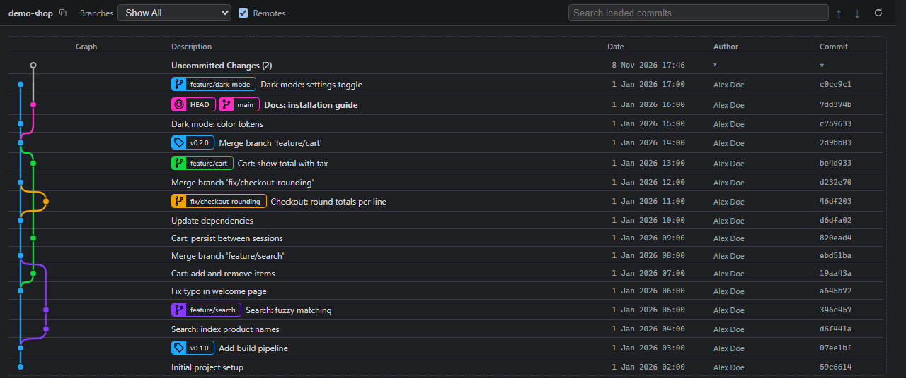

# Git Lineage

See your Git history as an interactive graph: branches, merges, tags, stashes and worktrees, with commit details, diffs and the everyday Git actions one right-click away.
Runs as a **VS Code extension** and as a **Claude Code plugin** (in the built-in browser pane), with the same interface in both.



Independently developed, licensed under GPL-3.0-only. No telemetry. The only network access is what you trigger yourself (with your own Git credentials): pushing or deleting a tag or branch on a remote, and a short check whether a tag or branch exists on the remote when you open a tag's menu or delete a branch.

## Install

**VS Code:** install *Git Lineage* from the Visual Studio Marketplace, then run **Open Git Lineage** from the Command Palette or click **Git Lineage** in the status bar.

**Claude Code:**

```
/plugin marketplace add roman-kiefer/git-lineage
/plugin install git-lineage@git-lineage
```

Then ask Claude to show the git graph, or run `/git-lineage:lineage-start`. Claude starts a small local server for the current repository and opens it in the browser pane. `/git-lineage:lineage-stop` closes the graph and stops the server; `/git-lineage:lineage-open-vscode` opens the current folder in VS Code. Requires Node.js 18 or later. Details: [Git Lineage in Claude Code](docs/claude-code.md).

## Features

- **Graph** of the history with its own lane layout: branches and merges as curves, lanes move left into freed columns, colors stay stable while you scroll and load more. Commits load page by page as you scroll. When there are more lanes than fit, the graph column scrolls sideways.
- **Ref chips** for local and remote branches (paired when they point to the same commit), tags, HEAD and stashes. Local branches show how far they are from their upstream: `↑2 ↓1` (commits to push / to pull, as of the last fetch), or `gone` when the upstream was deleted.
- **Uncommitted Changes** row above HEAD with the changed files of the working tree.
- **Commit details**: message, author, date and changed files with added/removed lines; click a file name for its Diff, the icon next to it to open the file (VS Code editors; a read-only view in the browser pane); copy hash and message.
- **Hover** over a commit dot: which branches and tags contain the commit, and whether HEAD does.
- **Worktrees**: switch between them in the toolbar; branches checked out in a linked worktree are marked on their chip and in the graph; other worktrees with changes get their own "Uncommitted Changes in &lt;name&gt;" row. Add, switch to, open (VS Code), copy the path of and remove worktrees from the context menu.
- **Context menu** (right-click or the menu key); everything except a plain branch checkout asks first in a short form:
  - create a tag (optionally push it) or a branch, add a worktree
  - check out a branch, remote branch, tag or commit (a local branch that lags behind its remote branch can be fast-forwarded on the way); cherry-pick; revert
  - merge into the current branch, rebase the current branch, reset (soft / mixed / hard)
  - on branch chips: delete the branch (an extra confirmation when it is not merged; optionally its upstream too) or the remote branch
  - on tag chips: an info block (annotated or lightweight, tagger, message, whether the tag is on origin, checked live), push and delete
  - on stash chips: apply, pop, drop
  - copy hash or subject, show the commit in a terminal (VS Code)
- **Interactive rebase** in its own view: reorder commits by dragging or with `Alt+↑/↓`, choose pick, reword, edit, squash, fixup or drop per commit; no text editor involved.
- **Stopped operations** (merge, cherry-pick, revert, rebase with conflicts or `edit`): a banner names the conflicted files (click to open) and offers Continue, Skip and Abort.
- **Search** in the loaded commits, branch filter, remote branches on/off, repository picker for multi-root workspaces.
- **Automatic refresh** after commits, checkouts, fetches, staging and saving files.
- Narrow windows hide the Author, Date and Commit columns before the description gets squeezed.

## Keyboard

| Key | Action |
|---|---|
| `g`, `Ctrl+G`, `Tab` | Focus the commit list (`g` outside input fields; in the Claude Code browser pane `Ctrl+G` is the page search) |
| `↑` / `↓`, `Home` / `End`, `PgUp` / `PgDn` | Select a commit in the list; open details follow the selection |
| `Ctrl+↑` / `Ctrl+↓` | Previous / next commit, also outside the list (e.g. in the search box) |
| `Enter`, `Ctrl+→` | Open the details |
| `Esc`, `Ctrl+←` | Close the details (the selection stays) |
| Menu key, `Shift+F10` | Context menu of the selected commit; inside it `↑` / `↓`, `Enter`, `Esc` |
| `/`, `Ctrl+F` | Search (`/` outside input fields); `Enter` / `Shift+Enter` jump between matches, `Esc` clears the search and continues in the list at the match |

A mouse click selects a commit and opens its details.

## Settings

| Setting | Default | Meaning |
|---|---|---|
| `gitLineage.pageSize` | 120 | Commits loaded per page |
| `gitLineage.showRemoteBranches` | true | Show remote branches when the view opens |
| `gitLineage.autoRefresh` | true | Refresh when HEAD, refs or the index change, or when a file in the repository is saved |
| `gitLineage.confirmDetachedCheckout` | true | Ask before checking out a commit or tag (detached HEAD) |
| `gitLineage.gitTimeoutSeconds` | 30 | Timeout for a single git command |
| `gitLineage.dateFormat` | `short` | Date column: `short` ("6 Nov 2026 13:41", your time zone), `iso` (the author's time), `local` (your system's regional format) or `relative` ("3 days ago") |

In Claude Code the same defaults apply; see [Git Lineage in Claude Code](docs/claude-code.md) for changing them.

## Feedback

Questions, problems and ideas: [GitHub issues](https://github.com/roman-kiefer/git-lineage/issues).

## Build from source

```
npm ci
npm run check      # type checks and tests
npm run package    # git-lineage-<version>.vsix
npm run plugin     # rebuilds the Claude Code plugin's server in claude-plugin/server
```

## License

[GPL-3.0-only](LICENSE)
